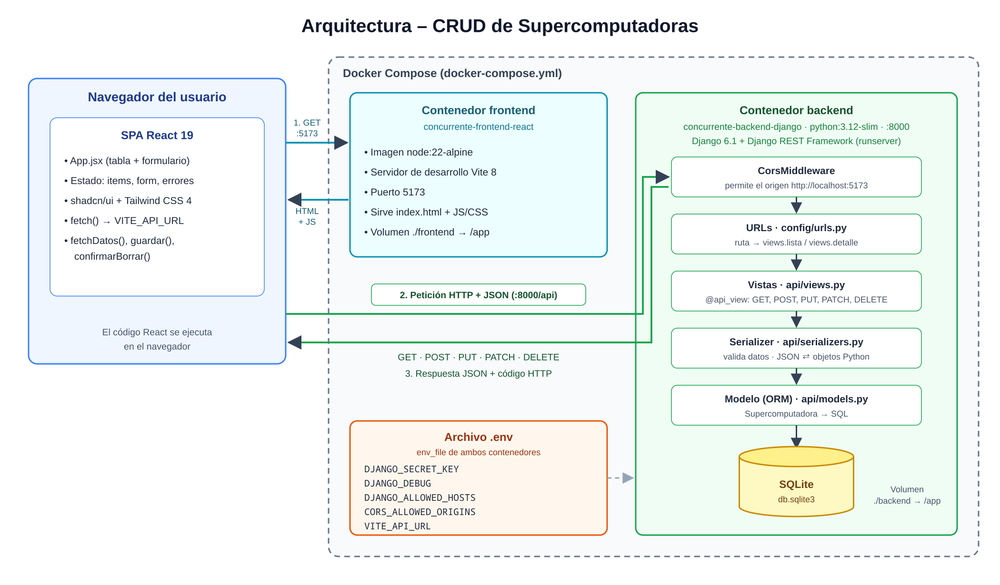
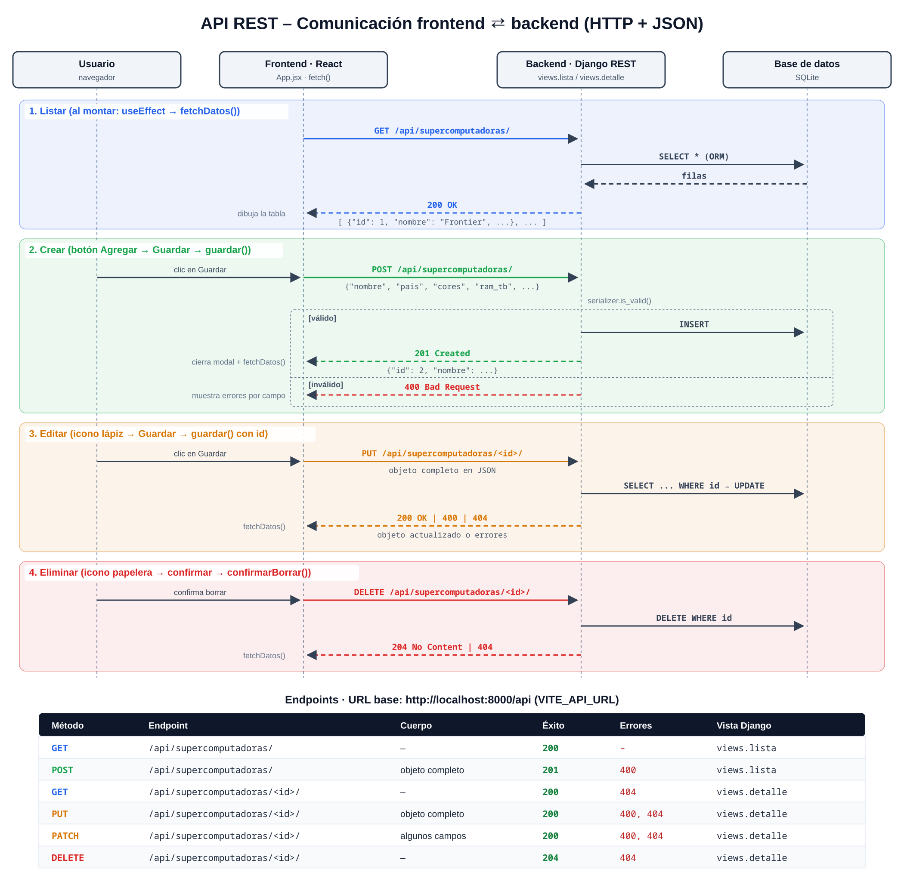

# Documentación del proyecto – CRUD de Supercomputadoras

Aplicación web full-stack para crear, listar, editar y eliminar **supercomputadoras**.
Está formada por una API REST construida con Django + Django REST Framework y un
frontend de una sola página (SPA) construido con React + Vite + Tailwind CSS + shadcn/ui. Ambos
corren en contenedores Docker orquestados con Docker Compose.

> Para la instalación y los comandos útiles, consulta el [README.md](README.md).

---

## Índice

1. [Arquitectura](#1-arquitectura)
2. [Tecnologías](#2-tecnologías)
3. [Estructura del proyecto](#3-estructura-del-proyecto)
4. [Infraestructura (Docker)](#4-infraestructura-docker)
5. [Backend](#5-backend)
   - [Proyecto Django (`config/`)](#51-proyecto-django-config)
   - [Modelo (`api/models.py`)](#52-modelo-apimodelspy)
   - [Migraciones (`api/migrations/`)](#53-migraciones-apimigrations)
   - [Serializer (`api/serializers.py`)](#54-serializer-apiserializerspy)
   - [Vistas (`api/views.py`)](#55-vistas-apiviewspy)
   - [URLs (`config/urls.py`)](#56-urls-configurlspy)
   - [Admin (`api/admin.py`)](#57-admin-apiadminpy)
   - [Otros archivos](#58-otros-archivos)
6. [Referencia de la API](#6-referencia-de-la-api)
7. [Frontend](#7-frontend)
8. [Ciclo de vida de una petición (de punta a punta)](#8-ciclo-de-vida-de-una-petición-de-punta-a-punta)
9. [Notas y limitaciones](#9-notas-y-limitaciones)

---

## 1. Arquitectura

El proyecto sigue una **arquitectura cliente–servidor** con frontend y backend
desacoplados que se comunican por HTTP usando JSON.



Cómo leer el diagrama:

1. **Navegador → contenedor frontend (`:5173`)**: al abrir la app, el navegador pide
   la página al servidor de Vite, que responde con `index.html` y el código JS/CSS.
   El contenedor frontend solo **sirve archivos**; no procesa datos.
2. **Navegador → contenedor backend (`:8000`)**: el código React ya se ejecuta *dentro
   del navegador*, por eso las llamadas a la API (`fetch`) van directamente del
   navegador al backend, no del contenedor frontend al backend.
3. **Dentro del backend**, cada petición atraviesa las capas en orden:
   `CorsMiddleware` (valida el origen) → URLs (elige la vista) → vista (decide según el
   método HTTP) → serializer (valida y convierte JSON) → modelo/ORM (genera SQL) →
   SQLite. La respuesta recorre el camino inverso y regresa como JSON con un código HTTP.
4. **Archivo `.env`**: Docker Compose lo carga en ambos contenedores (`env_file`); de
   ahí salen la configuración de Django, los orígenes CORS y `VITE_API_URL`.
5. **Volúmenes**: `./backend` y `./frontend` se montan en `/app` de cada contenedor,
   así los cambios de código se ven sin reconstruir la imagen y `db.sqlite3` persiste
   en el disco del host.

- **Frontend**: dibuja la interfaz y llama a la API con `fetch`. No contiene lógica
  de negocio más allá del formulario.
- **Backend**: expone una API REST. Internamente sigue el patrón por capas de Django:
  - **URLs** asocian una ruta con una vista.
  - **Vistas** reciben el método HTTP y deciden qué hacer.
  - **Serializers** validan la entrada y convierten entre objetos Python y JSON.
  - **Modelos** definen los datos y se comunican con la base de datos mediante el ORM.
- **Base de datos**: archivo SQLite guardado en `backend/db.sqlite3`.
- **CORS**: como el frontend (`:5173`) y el backend (`:8000`) son orígenes distintos,
  el backend permite explícitamente las peticiones desde los orígenes definidos en
  `CORS_ALLOWED_ORIGINS` (por defecto `http://localhost:5173`).
- **Configuración**: los valores sensibles o que cambian por entorno (clave secreta,
  `DEBUG`, hosts, URL de la API) viven en el archivo `.env`, no en el código.

---

## 2. Tecnologías

| Capa            | Tecnología               | Versión | Propósito                                          |
| --------------- | ------------------------ | ------- | -------------------------------------------------- |
| Backend         | Python                   | 3.12    | Entorno de ejecución (imagen `python:3.12-slim`)   |
| Backend         | Django                   | 6.1.2   | Framework web, ORM, admin, migraciones             |
| Backend         | Django REST Framework    | 3.18.3  | Serializers, `@api_view`, `Response`               |
| Backend         | django-cors-headers      | 4.9.0   | Permite que el frontend llame a la API             |
| Backend         | asgiref / sqlparse       | –       | Dependencias de Django                             |
| Base de datos   | SQLite                   | –       | Base de datos relacional basada en un archivo      |
| Frontend        | Node.js                  | 22      | Entorno de ejecución (imagen `node:22-alpine`)     |
| Frontend        | React                    | 19      | Librería de interfaces                             |
| Frontend        | Vite                     | 8       | Servidor de desarrollo y empaquetador              |
| Frontend        | Tailwind CSS             | 4       | Estilos con clases utilitarias (`@tailwindcss/vite`) |
| Frontend        | shadcn/ui                | –       | Componentes de UI copiados en `src/components/ui/` |
| Frontend        | radix-ui                 | 1.x     | Primitivas accesibles (Dialog, AlertDialog, Label, Slot) usadas por shadcn |
| Frontend        | class-variance-authority | 0.7     | Variantes de componentes (p. ej. `variant`, `size` en `Button`) |
| Frontend        | clsx / tailwind-merge    | 2 / 3   | Combinar clases de Tailwind sin conflictos (función `cn`) |
| Frontend        | tw-animate-css           | 1.x     | Animaciones de apertura/cierre de los modales      |
| Frontend        | lucide-react             | 1.x     | Iconos (Plus, Pencil, Trash2)                      |
| Frontend (dev)  | ESLint                   | 10      | Linter                                             |
| Infraestructura | Docker / Docker Compose  | v2      | Contenedores y orquestación                        |

---

## 3. Estructura del proyecto

```
.
├── README.md                 # Instalación y comandos
├── DOCUMENTATION.md          # Este archivo
├── docker-compose.yml        # Define los servicios backend y frontend
├── .env                      # Variables de entorno (no se sube a git)
├── .env.example              # Plantilla de .env
├── backend/
│   ├── Dockerfile
│   ├── requirements.txt      # Dependencias de Python
│   ├── manage.py             # CLI de Django
│   ├── config/               # Proyecto Django (configuración global)
│   │   ├── settings.py
│   │   ├── urls.py
│   │   ├── asgi.py
│   │   └── wsgi.py
│   └── api/                  # App de Django con la lógica de negocio
│       ├── models.py
│       ├── serializers.py
│       ├── views.py
│       ├── admin.py
│       ├── apps.py
│       ├── tests.py
│       └── migrations/
│           └── 0001_initial.py
└── frontend/
    ├── Dockerfile
    ├── package.json
    ├── vite.config.js        # Plugins de React y Tailwind + alias "@" → src/
    ├── jsconfig.json         # Alias "@" para el editor
    ├── components.json       # Configuración de shadcn/ui
    ├── index.html
    └── src/
        ├── main.jsx          # Punto de entrada de React
        ├── App.jsx           # Toda la interfaz (tabla, modal de formulario, modal de borrado)
        ├── index.css         # Importa Tailwind y define el tema de shadcn
        ├── lib/
        │   └── utils.js      # Función cn() para combinar clases
        └── components/ui/    # Componentes de shadcn (button, input, label, table, dialog, alert-dialog)
```

En Django, un **proyecto** (`config/`) contiene la configuración global y una **app**
(`api/`) es un módulo reutilizable con modelos, vistas, etc. Este proyecto tiene una
sola app: `api`.

---

## 4. Infraestructura (Docker)

### `docker-compose.yml`

Define dos servicios:

| Servicio   | Nombre del contenedor        | Puerto | Notas                                                                     |
| ---------- | ---------------------------- | ------ | ------------------------------------------------------------------------- |
| `backend`  | `concurrente-backend-django` | `8000` | Ejecuta `migrate` y después `runserver 0.0.0.0:8000`                      |
| `frontend` | `concurrente-frontend-react` | `5173` | Ejecuta el servidor de Vite; `depends_on: backend` para iniciar después   |

- **Volúmenes**: `./backend:/app` y `./frontend:/app` montan el código dentro de los
  contenedores, así los cambios se reflejan al momento (hot reload) sin reconstruir.
- `/app/node_modules` es un volumen anónimo para que la carpeta `node_modules` del
  contenedor no sea reemplazada por la del host.
- Como `./backend` está montado, `db.sqlite3` vive en el host y persiste entre reinicios.
- **`env_file: .env`**: ambos servicios cargan las variables del archivo `.env` de la
  raíz como variables de entorno del contenedor.
- Al agregar dependencias de npm hay que usar `docker compose up --build -V`; `-V`
  recrea el volumen anónimo de `node_modules`, si no el contenedor sigue usando el viejo.

### Variables de entorno (`.env`)

Para no tener valores sensibles en el código, la configuración se lee de variables de
entorno. El archivo `.env` está en `.gitignore`; `.env.example` sirve como plantilla:

```bash
cp .env.example .env   # y cambia DJANGO_SECRET_KEY
```

| Variable               | Usada por | Ejemplo                       | Descripción                                               |
| ---------------------- | --------- | ----------------------------- | --------------------------------------------------------- |
| `DJANGO_SECRET_KEY`    | backend   | cadena aleatoria larga        | Clave secreta de Django. **Obligatoria**: sin ella el backend no arranca. |
| `DJANGO_DEBUG`         | backend   | `True`                        | Modo debug; cualquier valor distinto de `True` lo desactiva. |
| `DJANGO_ALLOWED_HOSTS` | backend   | `localhost,127.0.0.1`         | Hosts permitidos, separados por comas.                    |
| `CORS_ALLOWED_ORIGINS` | backend   | `http://localhost:5173`       | Orígenes que pueden llamar a la API, separados por comas. |
| `VITE_API_URL`         | frontend  | `http://localhost:8000/api`   | URL base de la API.                                       |

- Django las lee con `os.environ` en `settings.py` (no se usa `python-dotenv`; Docker
  las inyecta).
- Vite solo expone al navegador las variables con prefijo `VITE_`, accesibles con
  `import.meta.env.VITE_API_URL`. Como se incluyen en el JavaScript que recibe el
  navegador, **nunca** deben contener secretos.
- Si se cambia el `.env`, hay que reiniciar los contenedores (`docker compose up`).

Para generar una clave secreta nueva:

```bash
docker compose exec backend python -c "from django.core.management.utils import get_random_secret_key; print(get_random_secret_key())"
```

> Si la clave contiene `$`, escríbelo como `$$` en el `.env`; Docker Compose interpreta
> `$` como variable.

### `backend/Dockerfile`

1. Parte de `python:3.12-slim`.
2. `PYTHONUNBUFFERED=1` para que los logs aparezcan de inmediato.
3. Instala `requirements.txt`, copia el código y ejecuta el servidor de desarrollo.
   (Compose sobrescribe el `CMD` para aplicar antes las migraciones).

### `frontend/Dockerfile`

1. Parte de `node:22-alpine`.
2. Instala las dependencias de `package.json` y copia el código.
3. Ejecuta `npm run dev -- --host` para que Vite escuche en todas las interfaces
   (necesario para poder acceder desde fuera del contenedor).

---

## 5. Backend

### 5.1 Proyecto Django (`config/`)

#### `settings.py`

Configuración global. Partes relevantes:

| Configuración          | Valor / significado                                                                                          |
| ---------------------- | ------------------------------------------------------------------------------------------------------------ |
| `SECRET_KEY`           | Se lee de `DJANGO_SECRET_KEY`. Si falta, Django falla al arrancar (`KeyError`) en lugar de usar una clave insegura. |
| `DEBUG`                | `True` solo si `DJANGO_DEBUG=True`; por defecto `False`.                                                     |
| `ALLOWED_HOSTS`        | Lista separada por comas de `DJANGO_ALLOWED_HOSTS` (por defecto `localhost`).                                |
| `INSTALLED_APPS`       | Apps integradas de Django + `rest_framework` (DRF) + `corsheaders` + nuestra app `api`.                      |
| `MIDDLEWARE`           | `CorsMiddleware` va **primero** para añadir las cabeceras CORS antes de que otro middleware responda.        |
| `CORS_ALLOWED_ORIGINS` | Lista separada por comas de la variable del mismo nombre (por defecto `http://localhost:5173`, la app de React). |
| `ROOT_URLCONF`         | `config.urls`: archivo donde se definen las rutas.                                                           |
| `DATABASES`            | SQLite en `BASE_DIR / 'db.sqlite3'`.                                                                          |
| `LANGUAGE_CODE`, `TIME_ZONE` | `en-us`, `UTC`.                                                                                        |

#### `wsgi.py` / `asgi.py`

Puntos de entrada para servidores de producción (WSGI, p. ej. Gunicorn; ASGI, p. ej.
Uvicorn). En desarrollo se usa `manage.py runserver`, por lo que se mantienen los
valores por defecto.

#### `manage.py`

Herramienta de línea de comandos de Django: `runserver`, `migrate`, `makemigrations`,
`createsuperuser`, etc.

---

### 5.2 Modelo (`api/models.py`)

Un **modelo** es una clase de Python que representa una tabla de la base de datos.
Cada atributo es una columna; el ORM de Django traduce operaciones de Python
(p. ej. `Supercomputadora.objects.all()`) a SQL.

```python
class Supercomputadora(models.Model):
  nombre = models.CharField(max_length=100, unique=True, error_messages={...})
  pais = models.CharField(max_length=100)
  cores = models.PositiveBigIntegerField()
  ram_tb = models.FloatField()
  almacenamiento_tb = models.FloatField()
  teraflops = models.FloatField()
  sistema_operativo = models.CharField(max_length=100)
```

| Campo               | Tipo                      | Restricciones                    | Descripción                       |
| ------------------- | ------------------------- | -------------------------------- | --------------------------------- |
| `id`                | `BigAutoField`            | Llave primaria, autogenerada     | Django lo agrega automáticamente  |
| `nombre`            | `CharField`               | máx. 100 caracteres, **único**   | Nombre de la supercomputadora     |
| `pais`              | `CharField`               | máx. 100 caracteres              | País de origen                    |
| `cores`             | `PositiveBigIntegerField` | ≥ 0                              | Número de núcleos                 |
| `ram_tb`            | `FloatField`              | –                                | RAM en terabytes                  |
| `almacenamiento_tb` | `FloatField`              | –                                | Almacenamiento en terabytes       |
| `teraflops`         | `FloatField`              | –                                | Rendimiento en TeraFLOPS          |
| `sistema_operativo` | `CharField`               | máx. 100 caracteres              | Sistema operativo                 |

- `unique=True` en `nombre` crea una restricción de unicidad en la base de datos. El
  `error_messages={'unique': 'Ya existe una supercomputadora con ese nombre'}`
  personalizado es el mensaje que se muestra al enviar un duplicado (DRF lo reutiliza,
  ver el serializer).
- `__str__` devuelve `nombre`, que es como se muestra cada objeto en el panel de
  administración de Django.

---

### 5.3 Migraciones (`api/migrations/`)

Las migraciones son archivos versionados que describen los cambios al esquema de la
base de datos.

- `0001_initial.py`: crea la tabla `api_supercomputadora` con los campos anteriores
  más la llave primaria `id`.
- Flujo cuando cambia el modelo:
  1. `python manage.py makemigrations` → genera un nuevo archivo de migración.
  2. `python manage.py migrate` → lo aplica a la base de datos.
- En este proyecto `migrate` se ejecuta automáticamente cada vez que arranca el
  contenedor del backend.

---

### 5.4 Serializer (`api/serializers.py`)

Un **serializer** es el puente entre el modelo y JSON. Tiene dos tareas:

1. **Serialización** (salida): instancia del modelo → dict → respuesta JSON.
2. **Deserialización + validación** (entrada): cuerpo JSON de la petición → datos
   validados → instancia del modelo guardada en la base de datos.

```python
class SupercomputadoraSerializer(serializers.ModelSerializer):
  class Meta:
    model = Supercomputadora
    fields = '__all__'
```

- `ModelSerializer` genera automáticamente los campos a partir del modelo, así que no
  hay que declararlos a mano.
- `fields = '__all__'` incluye todos los campos del modelo, incluido `id` (de solo
  lectura, ya que se autogenera).
- La validación también se deduce del modelo:
  - Campos obligatorios, `max_length`, tipos numéricos y `cores` no negativo.
  - Un `UniqueValidator` para `nombre`, que usa el mensaje `unique` personalizado del modelo.
- `serializer.save()` llama a `create()` (cuando no hay instancia) o a `update()`
  (cuando se pasa una instancia); ambos los provee `ModelSerializer`.

Ejemplo de respuesta con errores de validación (HTTP 400):

```json
{
  "nombre": ["Ya existe una supercomputadora con ese nombre"],
  "cores": ["A valid integer is required."]
}
```

El frontend lee este objeto para mostrar el error debajo de cada campo.

---

### 5.5 Vistas (`api/views.py`)

Las **vistas** reciben una petición HTTP y devuelven una respuesta HTTP. El proyecto
usa **vistas basadas en funciones** de DRF con el decorador `@api_view`, que:

- Restringe los métodos HTTP permitidos (los demás reciben `405 Method Not Allowed`).
- Convierte el cuerpo JSON en `request.data`.
- Permite devolver un `Response` de DRF que se renderiza como JSON.
- Convierte las excepciones de validación (`raise_exception=True`) en respuestas
  `400 Bad Request` automáticamente.

#### `lista(request)` — endpoint de la colección

Atiende `/api/supercomputadoras/`.

| Método | Qué hace                                                                                                              | Respuesta                    |
| ------ | --------------------------------------------------------------------------------------------------------------------- | ---------------------------- |
| `GET`  | Obtiene todos los registros (`Supercomputadora.objects.all()`) y los serializa con `many=True`.                       | `200` + lista JSON           |
| `POST` | Crea el serializer con `request.data`, valida (`is_valid(raise_exception=True)`), guarda y devuelve el objeto nuevo.  | `201` + objeto JSON, o `400` con errores |

#### `detalle(request, pk)` — endpoint de un solo objeto

Atiende `/api/supercomputadoras/<pk>/`.

Primero, `get_object_or_404(Supercomputadora, pk=pk)` carga el objeto o devuelve
`404 Not Found` si no existe.

| Método   | Qué hace                                                                          | Respuesta                  |
| -------- | --------------------------------------------------------------------------------- | -------------------------- |
| `GET`    | Serializa y devuelve el objeto.                                                   | `200` + objeto JSON        |
| `PUT`    | Actualización completa: hay que enviar todos los campos.                          | `200` + JSON, o `400`      |
| `PATCH`  | Actualización parcial: solo se validan/cambian los campos enviados (`partial=True`). | `200` + JSON, o `400`   |
| `DELETE` | Elimina el objeto.                                                                | `204 No Content`           |

`PUT` y `PATCH` comparten el mismo código; la única diferencia es
`partial=(request.method == "PATCH")`.

---

### 5.6 URLs (`config/urls.py`)

Las rutas asocian una URL con una vista:

```python
urlpatterns = [
    path('admin/', admin.site.urls),
    path('api/supercomputadoras/', views.lista),
    path('api/supercomputadoras/<int:pk>/', views.detalle),
]
```

- `admin/` → panel de administración integrado de Django.
- `api/supercomputadoras/` → `lista` (listar / crear).
- `api/supercomputadoras/<int:pk>/` → `detalle` (consultar / actualizar / eliminar).
  `<int:pk>` captura el id de la URL, lo convierte a `int` y lo pasa como argumento `pk`.

---

### 5.7 Admin (`api/admin.py`)

```python
admin.site.register(Supercomputadora)
```

Registra el modelo en el panel de administración de Django en
`http://localhost:8000/admin/`, que ofrece una interfaz lista para administrar los
registros. Se necesita un superusuario:

```bash
docker compose exec backend python manage.py createsuperuser
```

---

### 5.8 Otros archivos

| Archivo             | Propósito                                                                              |
| ------------------- | -------------------------------------------------------------------------------------- |
| `api/apps.py`       | Configuración de la app (`ApiConfig`, nombre `api`). Referenciada en `INSTALLED_APPS`. |
| `api/tests.py`      | Espacio para pruebas (actualmente vacío). Se ejecutan con `python manage.py test`.     |
| `api/__init__.py`   | Marca la carpeta como paquete de Python.                                               |
| `requirements.txt`  | Dependencias de Python con versión fija, instaladas en la imagen Docker.               |

---

## 6. Referencia de la API



El diagrama es un **diagrama de secuencia**: cada columna es un participante
(usuario, React, Django, SQLite) y el tiempo avanza hacia abajo. Las flechas continuas
son peticiones y las punteadas son respuestas. Muestra las cuatro operaciones que usa la
interfaz:

1. **Listar**: al montar el componente, `fetchDatos()` hace `GET` de la lista; Django
   consulta todas las filas y responde `200` con un arreglo JSON que React dibuja en
   la tabla.
2. **Crear**: `guardar()` envía `POST` con el objeto. El serializer valida los datos:
   - *válido* → `INSERT` y respuesta `201` con el objeto creado (incluye su `id`);
     React cierra el modal y recarga la lista.
   - *inválido* → `400` con los errores por campo, que React muestra en el formulario.
3. **Editar**: `guardar()` envía `PUT` a `/<id>/` con el objeto completo; responde
   `200` si se actualizó, `400` si hay errores de validación o `404` si el `id` no existe.
4. **Eliminar**: `confirmarBorrar()` envía `DELETE` a `/<id>/`; responde `204` (sin
   cuerpo) o `404`, y React recarga la lista.

La tabla inferior del diagrama resume todos los endpoints. `GET /<id>/` y `PATCH` están
disponibles en la API aunque la interfaz no los usa (se pueden probar con `curl` o con
la API navegable de DRF).

URL base: `http://localhost:8000/api/supercomputadoras/`

| Método   | Endpoint                         | Cuerpo             | Éxito | Errores      |
| -------- | -------------------------------- | ------------------ | ----- | ------------ |
| `GET`    | `/api/supercomputadoras/`        | –                  | `200` | –            |
| `POST`   | `/api/supercomputadoras/`        | Objeto completo    | `201` | `400`        |
| `GET`    | `/api/supercomputadoras/<id>/`   | –                  | `200` | `404`        |
| `PUT`    | `/api/supercomputadoras/<id>/`   | Objeto completo    | `200` | `400`, `404` |
| `PATCH`  | `/api/supercomputadoras/<id>/`   | Algunos campos     | `200` | `400`, `404` |
| `DELETE` | `/api/supercomputadoras/<id>/`   | –                  | `204` | `404`        |

Objeto de ejemplo:

```json
{
  "id": 1,
  "nombre": "Frontier",
  "pais": "Estados Unidos",
  "cores": 8699904,
  "ram_tb": 9408,
  "almacenamiento_tb": 700000,
  "teraflops": 1194000,
  "sistema_operativo": "HPE Cray OS"
}
```

Prueba rápida con `curl`:

```bash
curl http://localhost:8000/api/supercomputadoras/

curl -X POST http://localhost:8000/api/supercomputadoras/ \
  -H "Content-Type: application/json" \
  -d '{"nombre":"Frontier","pais":"Estados Unidos","cores":8699904,"ram_tb":9408,"almacenamiento_tb":700000,"teraflops":1194000,"sistema_operativo":"HPE Cray OS"}'

curl -X PATCH http://localhost:8000/api/supercomputadoras/1/ \
  -H "Content-Type: application/json" -d '{"teraflops":1200000}'

curl -X DELETE http://localhost:8000/api/supercomputadoras/1/
```

Como la API navegable de DRF está habilitada, abrir estas URLs en el navegador también
muestra una página HTML interactiva.

---

## 7. Frontend

Toda la interfaz está en `frontend/src/App.jsx`; `main.jsx` la monta en `index.html`.

- **`API`**: se construye con `import.meta.env.VITE_API_URL` + `/supercomputadoras/`.
- **`CAMPOS`**: lista que describe cada campo (`key`, `label`, `type`). Controla tanto
  las columnas de la tabla como los inputs del formulario, así que agregar un campo
  solo requiere un cambio aquí (además del modelo en el backend).
- **Estado** (`useState`):
  - `items` – supercomputadoras cargadas desde la API.
  - `form` – objeto que se está creando/editando (`null` = modal cerrado). Si tiene
    `id` es una edición; si no, una creación.
  - `deletePopUp` – objeto pendiente de eliminar (`null` = popup cerrado).
  - `errores` – errores de validación devueltos por la API.
- **Flujo de datos**:
  - `fetchDatos()` → `GET` de la lista; se llama al montar (`useEffect`) y después de
    cada cambio.
  - `guardar()` → `POST` (nuevo) o `PUT` (edición). Si recibe `400`, guarda el JSON
    de errores en `errores` y muestra el primer mensaje debajo de cada campo.
  - `confirmarBorrar()` → `DELETE` y recarga.
- **Estilos**: clases utilitarias de Tailwind; iconos de `lucide-react`.

### Componentes de shadcn/ui

[shadcn/ui](https://ui.shadcn.com) no es una librería que se instala como dependencia:
su CLI **copia el código** de cada componente en `src/components/ui/`, así que se puede
leer y modificar libremente. Los componentes se construyen sobre primitivas de
`radix-ui` (accesibilidad, manejo de foco, teclado) y se estilizan con Tailwind.

| Componente en `App.jsx`             | Archivo             | Uso                                                        |
| ----------------------------------- | ------------------- | ---------------------------------------------------------- |
| `Button`                            | `button.jsx`        | Agregar, editar, borrar, guardar, cancelar (`variant`: `default`, `outline`, `ghost`; `size`: `icon-sm` para los iconos) |
| `Table`, `TableHeader`, `TableRow`, `TableHead`, `TableBody`, `TableCell` | `table.jsx` | Tabla de supercomputadoras |
| `Dialog`, `DialogContent`, `DialogHeader`, `DialogTitle`, `DialogFooter` | `dialog.jsx` | Modal del formulario para agregar/editar |
| `Input`, `Label`                    | `input.jsx`, `label.jsx` | Campos del formulario; `aria-invalid` marca en rojo los campos con error |
| `AlertDialog` y subcomponentes      | `alert-dialog.jsx`  | Confirmación antes de eliminar                             |

- Los modales se controlan con el estado existente: `open={!!form}` y
  `open={!!deletePopUp}`; `onOpenChange` los cierra al presionar `Esc`, hacer clic fuera
  o en la `X`.
- **Tema**: `index.css` define variables CSS (`--primary`, `--border`, etc., base
  *slate*) que Tailwind expone como clases (`bg-primary`, `text-muted-foreground`...).
  Cambiar un color ahí actualiza todos los componentes.
- **`cn()`** (`src/lib/utils.js`): combina clases con `clsx` y resuelve conflictos de
  Tailwind con `tailwind-merge`, permitiendo sobrescribir estilos vía `className`.
- **Alias `@`**: `@/components/ui/button` apunta a `src/components/ui/button.jsx`
  (configurado en `vite.config.js` y `jsconfig.json`).
- Para agregar otro componente:

  ```bash
  cd frontend && npx shadcn@latest add <componente>
  ```

---

## 8. Ciclo de vida de una petición (de punta a punta)

Ejemplo: el usuario crea una nueva supercomputadora.

1. El usuario llena el formulario y hace clic en **Guardar**.
2. React envía `POST /api/supercomputadoras/` con un cuerpo JSON.
3. El navegador incluye `Origin: http://localhost:5173`; `CorsMiddleware` verifica
   que esté permitido y añade las cabeceras CORS a la respuesta.
4. El resolvedor de URLs de Django empata `api/supercomputadoras/` → `views.lista`.
5. `@api_view` confirma que `POST` está permitido y convierte el JSON en `request.data`.
6. `SupercomputadoraSerializer(data=request.data)` valida tipos, campos obligatorios
   y que `nombre` sea único.
   - Si no es válido → `400` con un error por campo → React los muestra en el formulario.
7. `serializer.save()` → el ORM ejecuta un `INSERT` en SQLite.
8. La vista devuelve `201` con el objeto creado en JSON.
9. React cierra el modal y llama a `fetchDatos()` para refrescar la tabla.

---

## 9. Notas y limitaciones

- **Configuración solo para desarrollo**: los servidores de desarrollo de Django y Vite
  no son aptos para producción. Para producción habría que poner `DJANGO_DEBUG=False`
  y ajustar `DJANGO_ALLOWED_HOSTS`, `CORS_ALLOWED_ORIGINS` y `VITE_API_URL`.
- **Clave antigua en el historial**: versiones anteriores de `settings.py` tenían la
  `SECRET_KEY` escrita en el código y sigue visible en el historial de git; no debe
  reutilizarse.
- **Sin autenticación**: cualquier cliente permitido por CORS (y cualquier cliente que
  no sea navegador, como `curl`) puede leer y modificar los datos.
- **Concurrencia**: `runserver` de Django atiende cada petición en su propio hilo, así
  que varias peticiones pueden atenderse al mismo tiempo. SQLite permite lecturas
  concurrentes pero solo una escritura a la vez (bloquea el archivo de la base de
  datos), lo cual es suficiente para esta escala. La restricción de unicidad de
  `nombre` la aplica la base de datos, así que no se pueden guardar duplicados aunque
  dos peticiones inserten el mismo nombre en el mismo instante. Sin embargo, en esa
  condición de carrera ambas pueden pasar la validación del serializer y la segunda
  inserción falla con un `IntegrityError` (HTTP 500) en lugar de un `400` limpio.
- **Pruebas**: `api/tests.py` todavía está vacío.
